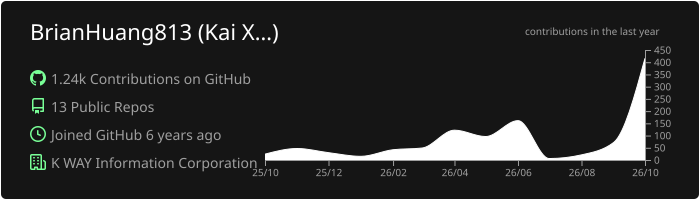

 

  <a href="https://kxhuang.dev">kxhuang.dev</a> &nbsp;·&nbsp;
  <a href="https://kxhuang.dev/KaiXiu_Huang_CV.pdf">CV</a> &nbsp;·&nbsp;
  <a href="https://www.linkedin.com/in/kai-xiu-huang-768429253/">LinkedIn</a> &nbsp;·&nbsp;
  <a href="https://x.com/BrianHuang18">X</a> &nbsp;·&nbsp;
  <a href="mailto:work@kxhuang.dev">work@kxhuang.dev</a>

 

### Projects &nbsp;專案

  
  
  
  
  
  

### Writing &nbsp;文章

<!-- BLOG-POST-LIST:START -->
- [Blink Market — A Binary Prediction Market Protocol on Sui](https://kxhuang.dev/2026/06/06/BlinkMarket/) 2026-06-06
- [What Gives Bitcoin Value? Consensus, Scarcity, and Utility](https://kxhuang.dev/2026/05/01/post_bitcoin_and_values/) 2026-05-01
- [SuiAudit — An AI Audit Tool for Sui Move Smart Contracts](https://kxhuang.dev/2026/03/03/SuiAudit/) 2026-03-03
- [Can a 7B Model Beat Frontier LLMs at Auditing Move? Inside SuiAudit Pure1](https://kxhuang.dev/2026/02/25/SuiAudit_paper/) 2026-02-25
- [Sui Bootcamp: Building an On-Chain Chat App in 24 Hours](https://kxhuang.dev/2025/12/10/Sui_bootcamp/) 2025-12-10
<!-- BLOG-POST-LIST:END -->

→ <a href="https://kxhuang.dev/blog">All writing</a>

### Activity &nbsp;動態

  

  <picture>
    <source media="(prefers-color-scheme: dark)" srcset="https://raw.githubusercontent.com/BrianHuang813/BrianHuang813/output/github-contribution-grid-snake-dark.svg" />
    
  </picture>

